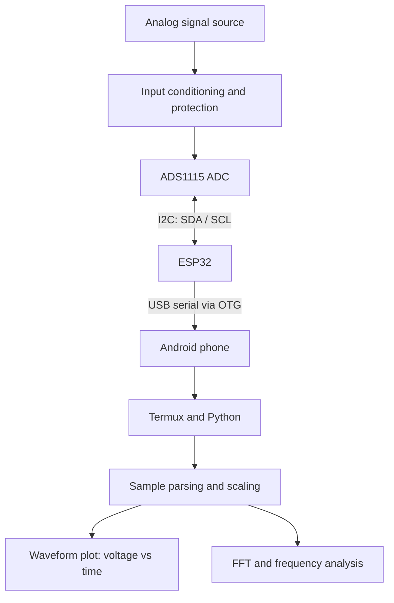

# Android-Based Oscilloscope and Signal Analyzer

A portable, low-cost oscilloscope and signal-analysis project that uses an **ESP32**, an **ADS1115 external ADC**, and an **Android phone** to acquire low-speed analog signals and visualize them as waveforms. Python tools running in Termux can be used for plotting and frequency-domain analysis.

> **Important performance note:** The ADS1115 supports up to 860 samples per second (SPS). This design is intended for low-frequency signals and demonstrations of sampling, waveform visualization, and FFT analysis—not for high-speed or general-purpose oscilloscope measurements. The practical usable bandwidth is lower than the theoretical Nyquist limit.

## Table of Contents

- [Overview](#overview)
- [Objectives](#objectives)
- [System Architecture](#system-architecture)
- [Features](#features)
- [Hardware Requirements](#hardware-requirements)
- [Software Requirements](#software-requirements)
- [Pin Connections](#pin-connections)
- [How It Works](#how-it-works)
- [Setup](#setup)
- [Running the System](#running-the-system)
- [Signal Processing](#signal-processing)
- [Testing and Validation](#testing-and-validation)
- [Safety and Measurement Limits](#safety-and-measurement-limits)
- [Troubleshooting](#troubleshooting)
- [Limitations](#limitations)
- [Future Enhancements](#future-enhancements)
- [Project Structure](#project-structure)
- [References](#references)

## Overview

Traditional oscilloscopes can be expensive or inconvenient for basic learning and field demonstrations. This project explores a portable alternative by combining an ESP32 microcontroller, an ADS1115 16-bit delta-sigma ADC, and an Android phone.

The ADS1115 samples a conditioned input signal. The ESP32 reads the ADC over I²C and forwards sample data to the Android device, typically over USB serial through a USB-OTG adapter. On Android, a Python application can parse the samples, plot voltage against time, and calculate an FFT to inspect the signal's frequency content.

This repository describes the hardware and software architecture. Pin assignments and example setup commands below are a reference configuration; adjust them to match the actual firmware, Android device, and wiring used in your build.

## Objectives

- Acquire low-frequency analog signals using an external ADC.
- Transfer samples from the ESP32 to an Android device.
- Display sampled data as a voltage-versus-time waveform.
- Demonstrate FFT-based frequency analysis.
- Build a compact, low-cost educational tool for learning sampling and digital signal processing.

## System Architecture



**Data path:** Signal source → safe input-conditioning circuit → ADS1115 → ESP32 → USB serial/OTG → Android → Python visualization and analysis.

## Features

The following are project capabilities or intended software functions; only mark a feature as implemented after verifying it in your current build.

- External 16-bit ADC acquisition through ADS1115.
- ESP32-based sample collection and data transfer.
- Android-side data processing using Python.
- Time-domain waveform visualization.
- FFT-based frequency-domain analysis.
- Portable setup using a phone and USB-OTG connection.
- Expandable architecture for filtering, peak detection, triggering, and data export.

## Hardware Requirements

| Component | Purpose |
|---|---|
| ESP32 DevKit V1 (ESP-WROOM-32) | Reads the ADC and transfers samples |
| ADS1115 ADC module | 16-bit, four-input-channel delta-sigma ADC |
| Android phone | Runs the terminal and visualization tools |
| USB-OTG adapter/cable | Connects the ESP32 USB interface to the phone |
| Breadboard and jumper wires | Prototyping and interconnection |
| Resistors for a divider/input conditioner | Reduces or biases the input as required |
| Common ground connection | Establishes a shared signal reference |

Optional components such as series resistors, clamps, or an op-amp buffer may be used in an input-conditioning circuit, but their values and topology must be designed for the expected signal range.

## Software Requirements

### ESP32

- Arduino IDE or another ESP32-compatible development environment.
- An ADS1115 library compatible with the firmware framework.
- Firmware that reads the ADS1115 and sends samples using a documented serial format.

### Android

- Termux installed from a trusted, maintained distribution.
- Python 3.
- Python packages as needed:
  - `numpy` for numerical processing.
  - `matplotlib` for plotting.
  - `scipy` for optional signal-processing functions.
  - `pyserial` for serial communication where supported by the device and Termux setup.

Example Termux setup:

```bash
pkg update && pkg upgrade
pkg install python
python -m pip install numpy matplotlib scipy pyserial
```

Plotting backends vary by Android setup. Depending on the chosen workflow, Matplotlib may require Termux:X11, another supported display backend, or a browser-based plotting interface. A rooted phone or Magisk is **not inherently required** for USB serial acquisition or Python analysis.

## Pin Connections

### ESP32 to ADS1115

The following is a common ESP32 DevKit V1 / ADS1115 I²C configuration. Verify the labels on your specific boards before powering them.

| ADS1115 pin | ESP32 connection | Notes |
|---|---|---|
| VDD | 3V3 | Power the ADC module at 3.3 V for direct ESP32 I²C compatibility |
| GND | GND | Common ground |
| SDA | GPIO 21 | I²C data on the reference ESP32 configuration |
| SCL | GPIO 22 | I²C clock on the reference ESP32 configuration |
| ADDR | GND | Selects the usual I²C address `0x48` |
| ALERT/RDY | Not connected | Optional; can be used for conversion-ready signaling |

Some ADS1115 breakout boards have different onboard pull-ups or power arrangements. Check the board documentation and ensure I²C pull-ups do not raise ESP32-connected lines above 3.3 V.

### Analog input

| Signal path | Connection guidance |
|---|---|
| Signal source output | Input-conditioning circuit first |
| Conditioned signal | ADS1115 A0 for a single-channel example |
| Signal source ground | Circuit common ground, unless an appropriate isolated/differential measurement setup is used |

**Do not connect an unknown signal directly to A0.** The ADS1115 input must remain within its supply rails and absolute maximum ratings. With the module powered at 3.3 V, a simple single-ended input should remain near 0–3.3 V and must not go below ground. The selected programmable-gain range is a measurement range, not permission to exceed the ADC's electrical limits.

For bipolar or AC signals, design a suitable attenuator and bias/conditioning circuit so the ADC pin stays within its permitted range. Confirm the circuit using a multimeter before connecting the signal source.

## How It Works

1. **Signal conditioning:** The input circuit scales and, where necessary, biases the signal to fit the ADC's permitted input range.
2. **Sampling:** The ADS1115 converts the analog input to digital samples.
3. **Acquisition:** The ESP32 reads the conversion results over I²C. The firmware should attach a sample index or timestamp and use a clearly specified serial data format.
4. **Transfer:** The ESP32 sends samples to the Android phone over USB serial through OTG. The phone must support USB host/OTG operation.
5. **Parsing:** A Python program reads the incoming serial stream, validates the records, and converts raw ADC codes to voltage using the configured gain and calibration.
6. **Waveform display:** The program plots voltage against time.
7. **Frequency analysis:** An FFT estimates the frequency components in a finite block of samples.

### Example serial format

The firmware and Android parser must agree on one format. A simple line-oriented format could be:

```text
sample_index,raw_adc
0,125
1,132
2,141
3,137
```

This is an example protocol, not a claim that every firmware version already emits this exact format. If your firmware sends voltage values, timestamps, or binary packets instead, update the parser accordingly.

## Setup

1. Wire the ESP32 and ADS1115 with the power disconnected.
2. Check VDD, GND, SDA, SCL, and the ADDR pin.
3. Confirm the I²C address (commonly `0x48` when ADDR is grounded).
4. Flash ESP32 firmware that reads the ADS1115 and emits sample data.
5. Install Termux and the required Python packages on Android.
6. Connect the ESP32 to the phone with a compatible USB-OTG adapter.
7. Grant USB access if Android prompts for permission.
8. Start the serial reader and plotting application.
9. Begin with a known, low-voltage signal and verify the readings before testing other inputs.

## Running the System

The exact command depends on the filenames and serial-port handling used by your implementation. A typical Python workflow is:

1. Identify the USB serial device exposed by the Android/Termux environment.
2. Configure the application with the correct serial device, baud rate, ADC gain, sample rate, and input scaling.
3. Start the reader and collect a finite block of samples.
4. View the waveform and, if implemented, the FFT plot.

Do not assume a serial device path or baud rate without checking your firmware and Android setup. Some Android devices expose USB serial differently, and Python `pyserial` access may require additional permissions or a USB-host library.

## Signal Processing

### Sampling and time axis

For a uniform sampling rate \(f_s\), the time between samples is:

\[
T_s = \frac{1}{f_s}
\]

For \(N\) samples, a simple time axis is:

\[
t_n = \frac{n}{f_s}, \quad n=0,1,\ldots,N-1
\]

Use the **actual effective sample rate**, not just the requested delay in firmware. I²C transactions, conversion time, serial transfer, and Android scheduling can affect timing.

### Nyquist limit

The Nyquist frequency is:

\[
f_N = \frac{f_s}{2}
\]

At the ADS1115 maximum data rate of 860 SPS, the theoretical Nyquist frequency is 430 Hz. In practice, the usable bandwidth is lower, and a stable waveform generally requires multiple samples per cycle. Frequencies above Nyquist can alias into lower frequencies unless appropriately filtered.

### FFT

The FFT transforms a block of time-domain samples into frequency-domain components. To improve interpretation:

- Remove the DC mean when analyzing AC components.
- Apply a window, such as Hann, when the captured block does not contain an integer number of cycles.
- Use the correct sample rate when mapping FFT bins to frequency.
- Treat FFT peak estimates as limited by sample count, windowing, noise, and sample-clock accuracy.

The ADS1115 is a delta-sigma ADC designed for relatively slow measurements. It is not a replacement for a high-speed oscilloscope ADC.

## Testing and Validation

Use a low-voltage function generator or another known, safe signal source. Record actual observations in the table rather than claiming results that have not been measured.

| Test | Procedure | Expected check |
|---|---|---|
| I²C communication | Scan the bus or read the ADC configuration | ADS1115 responds at the configured address |
| DC input | Apply a known voltage within the input range | Displayed voltage is reasonably close to the reference meter |
| Serial transfer | Capture a stream of samples | Records arrive in the expected format without persistent corruption |
| Waveform plot | Apply a low-frequency periodic signal | Plot shape and period broadly match the source |
| Frequency estimate | Apply a known low-frequency tone | FFT peak is near the expected frequency, within the system's resolution |
| Input limits | Check the conditioning circuit with a meter | ADC input remains within its allowed voltage range |

For voltage calibration, compare several known input levels and document the error. For frequency testing, use a source whose frequency is comfortably below the practical bandwidth limit. Include the sample rate, number of samples, and test equipment in any report of measured accuracy.

## Safety and Measurement Limits

- **Never connect this project directly to mains electricity, wall outlets, or other hazardous voltages.**
- Do not probe power electronics, automotive ignition, or unknown circuits without suitable isolation, rated probes, and a properly designed front end.
- Keep every ADS1115 input within the device's absolute maximum ratings. A voltage divider alone does not automatically make a circuit safe.
- Share grounds only when appropriate for the circuit under test. Grounding can create short circuits or unsafe paths.
- Disconnect power before changing wiring.
- The ADS1115's 16-bit resolution does not guarantee 16-bit measurement accuracy; noise, reference/supply variation, gain, input conditioning, and calibration affect results.

## Troubleshooting

| Problem | Things to check |
|---|---|
| ADS1115 not detected | Check 3.3 V supply, common ground, SDA/SCL wiring, pull-ups, and I²C address |
| No serial data on Android | Check OTG support, USB permissions, cable, firmware output, serial device access, and baud rate |
| Garbled sample records | Ensure both ends use the same baud rate and serial format |
| Waveform voltage is wrong | Verify ADC gain, raw-code conversion, input divider ratio, bias offset, and calibration |
| Waveform looks unstable | Verify sample timing, input grounding, source quality, and noise pickup |
| FFT frequency is wrong | Use the measured sample rate, enough samples, appropriate windowing, and a signal below the practical bandwidth limit |
| Matplotlib window does not open | Configure a supported Android plotting backend or use a browser-based display approach |

## Limitations

- ADS1115 sampling rate is limited to 860 SPS, restricting the project to low-speed signals.
- The analog input front end determines safe voltage range, bandwidth, and input impedance.
- Android USB and plotting behavior varies by device and software environment.
- Timing jitter and serial throughput can affect waveform fidelity if sample collection and transfer are not designed carefully.
- This is an educational prototype and must not be used as certified test equipment or for safety-critical measurements.

## Future Enhancements

- Use a faster ADC or ESP32 I²S-based acquisition path for higher sample rates.
- Add a protected, calibrated input stage with selectable attenuation and AC/DC coupling.
- Implement trigger modes and pre-trigger buffering.
- Add peak-to-peak voltage, RMS, period, and frequency measurements.
- Add digital filters and CSV export.
- Build a dedicated Android interface or browser-based dashboard.
- Add Wi-Fi streaming where USB is inconvenient.
- Add calibration settings and automated validation tests.

## Project Structure

A suggested repository structure is:

```text
android-based-oscilloscope/
├── firmware/
│   └── esp32_ads1115_acquisition/
├── android/
│   └── python_analyzer/
├── docs/
│   ├── block-diagram.md
│   └── wiring.md
├── tests/
├── README.md
└── LICENSE
```

Adjust this structure to match the files that actually exist in your repository. Avoid adding empty folders merely to make the repository look complete.

## References

- Texas Instruments, **ADS111x Low-Power, 16-Bit, I²C-Compatible ADCs**: https://www.ti.com/product/ADS1115
- Espressif, **ESP32 Documentation**: https://docs.espressif.com/projects/esp-idf/en/stable/esp32/
- Termux documentation: https://termux.dev/
- NumPy FFT documentation: https://numpy.org/doc/stable/reference/routines.fft.html
- SciPy signal processing documentation: https://docs.scipy.org/doc/scipy/reference/signal.html

## Academic Use

This project demonstrates embedded data acquisition, USB communication, sampling theory, and digital signal processing. If you use it in a college report or publication, include your own circuit diagram, firmware version, test results, and properly formatted citations.

---

**Maintainer:** Yeshwanth Botsa  
**Project:** Android-Based Oscilloscope and Signal Analyzer  
**Status:** Educational prototype — update this status to reflect the verified state of your implementation.
